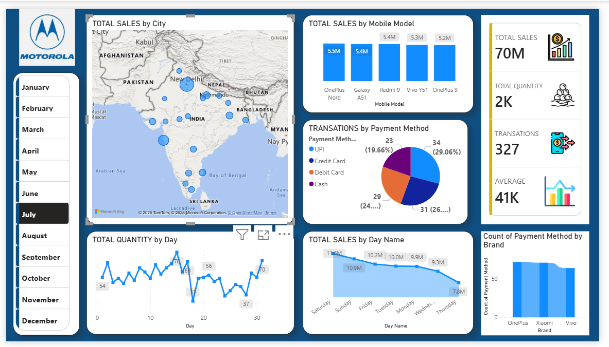

# Motorola-dashboard
# 📱 Motorola Sales Analytics Dashboard | Power BI

An interactive business intelligence dashboard built with **Microsoft Power BI, DAX, and Excel** to analyze mobile phone sales, customer payment behavior, product performance, and daily sales trends. The dashboard transforms sales data into visual insights that can support data-driven business decisions.

## 📌 Table of Contents

- Project Overview
- Business Problem
- Project Objectives
- Tech Stack
- Data Source and Preparation
- Dashboard Features
- Key Business Questions
- Business Insights and Applications
- DAX Measures and Calculations
- Interview Preparation Questions
- How to Use the Dashboard
- Project Files
- Future Improvements

## 1. 📊 Project Overview

The Motorola Sales Analytics Dashboard provides an interactive view of mobile phone sales performance across different cities, mobile models, payment methods, brands, and days.

It combines KPI cards, a geographic sales map, bar charts, a pie chart, and trend charts to help users explore sales patterns and compare product and payment performance.

**Project type:** Data Analytics / Business Intelligence  
**Industry:** Mobile Phones and Consumer Electronics  
**Primary tool:** Microsoft Power BI  
**Key skills:** Data Cleaning, Data Visualization, DAX, KPI Analysis, Business Intelligence, and Exploratory Data Analysis (EDA)

## 2. 🎯 Business Problem

Mobile phone businesses generate sales data across products, locations, payment channels, and transaction dates. However, raw data alone does not make it easy to identify top-performing models, regional sales patterns, or changes in customer purchasing behavior.

The key challenge is to convert this data into an interactive reporting solution that enables stakeholders to monitor performance and investigate business trends efficiently.

### Project objectives

- Monitor overall sales, quantities sold, transaction counts, and average sales.
- Compare sales performance across mobile models and brands.
- Analyze payment method distribution.
- Explore geographic differences in sales.
- Identify daily fluctuations in sales quantity.
- Enable month-based filtering for more focused analysis.
- Support evidence-based decisions about product performance and sales strategy.

## 3. 🛠️ Tech Stack

The dashboard uses the following tools and analytical concepts:

- **Microsoft Power BI Desktop:** Dashboard development, report design, interactive visuals, and data exploration.
- **DAX (Data Analysis Expressions):** Measures, aggregations, KPI calculations, and analytical logic.
- **Microsoft Excel:** Source-data inspection, preparation, and validation, where applicable.
- **Power Query:** Data cleaning, transformation, data-type correction, and preparation, where used.
- **Data Visualization:** KPI cards, maps, bar charts, pie charts, and line charts.
- **Data Modeling:** Organizing tables and relationships to support accurate filtering and aggregation, where applicable.

**Project output:** Power BI report (`.pbix`) and dashboard preview (`.png`).

## 4. 📂 Data Source and Preparation

**Data source:** The sales dataset used in this project. Add the original dataset name and source URL here when available.

The dashboard analyzes sales information across dimensions such as:

- Transaction date and month
- City or geographic location
- Mobile model
- Brand
- Payment method
- Quantity sold
- Sales amount
- Transaction identifier

These are the analytical dimensions represented in the dashboard; the exact source columns and data types should be confirmed against the dataset.

### Data preparation workflow

1. Import the source dataset into Power BI or Excel.
2. Inspect column names, data types, missing values, and duplicate records.
3. Standardize dates, text categories, numeric fields, and payment labels.
4. Validate sales and quantity values against the source data.
5. Create required calculated measures using DAX.
6. Configure relationships and date fields where required.
7. Build visuals and configure cross-filtering.
8. Validate dashboard totals against independent calculations.

*Note: Include only the cleaning and modeling steps that you actually performed in the project.*

## 5. 📈 Dashboard Features and Visual Walkthrough

### A. KPI Cards — Overall Performance

The dashboard displays four headline metrics:

| KPI | Displayed value | Purpose |
|---|---:|---|
| Total Sales | 70M | Tracks aggregated sales value |
| Total Quantity | 2K | Tracks units sold |
| Transactions | 327 | Tracks transaction volume |
| Average | 41K | Shows an average metric; exact definition requires validation |

These KPIs provide a quick overview of performance and help users compare the headline numbers with the detailed charts.

**Analytical question:** Is the business generating strong sales value relative to the number of transactions and units sold?

### B. Total Sales by City — Geographic Analysis

A map visualizes sales geographically, allowing users to investigate the distribution of sales across locations.

**What it helps analyze:**
- Which cities contribute the most sales?
- Are sales concentrated in specific geographic areas?
- Which locations might require further investigation?

**Business application:** Geographic analysis can support regional performance reviews and help prioritize markets for further research.

### C. Total Sales by Mobile Model — Product Performance

A column chart compares sales across mobile models, including OnePlus Nord, Galaxy A51, Redmi 9, Vivo Y51, and OnePlus 9.

The displayed labels include approximately 5.5M, 5.4M, and 5.3M for some models.

**What it helps analyze:**
- Which models generate the highest sales?
- How closely do the leading models perform?
- Which products might warrant additional promotional attention?

**Business application:** Product-level analysis helps stakeholders compare model performance and investigate differences in demand.

### D. Transactions by Payment Method — Customer Payment Behavior

A pie chart compares transactions across UPI, credit card, debit card, and cash.

**What it helps analyze:**
- Which payment methods account for the largest transaction share?
- How does digital payment usage compare with cash?
- Are there meaningful differences in customer payment preferences?

**Business application:** Understanding payment preferences can inform checkout improvements and payment-service planning.

### E. Total Quantity by Day — Daily Trend Analysis

A line chart displays daily quantities across the selected period.

**What it helps analyze:**
- Which days show higher or lower quantities?
- Are there sudden changes in daily sales volume?
- Are there potential peaks or dips worth investigating?

**Business application:** Daily trend analysis can help identify unusual activity and support further investigation into demand patterns.

### F. Total Sales by Day Name — Day-of-Week Comparison

A line chart compares sales across Saturday, Sunday, Friday, Tuesday, Monday, Wednesday, and Thursday as displayed in the report.

**What it helps analyze:**
- Which days have higher sales values?
- Does sales performance vary across weekdays and weekends?
- Which day-level patterns should be validated over multiple weeks?

**Important:** Confirm the aggregation and weekday sorting. The visual's current order does not follow the usual Monday-to-Sunday sequence, and the displayed values alone do not establish a recurring weekly pattern.

### G. Count of Payment Method by Brand — Brand-Level Comparison

A column chart compares payment-method counts across brands such as OnePlus, Xiaomi, and Vivo.

**What it helps analyze:**
- How does payment transaction volume vary by brand?
- Are some brands associated with more recorded payment transactions?
- Do brands differ in customer payment behavior?

**Business application:** This visual can support brand-level transaction comparisons. It should not be interpreted as sales revenue or market share without the corresponding measures and denominators.

### H. Month Slicer — Interactive Filtering

The left-hand panel provides a month selector from January through December.

Users can select a month to filter supported visuals and examine performance for a specific period.

**Benefit:** The slicer makes it easier to compare periods and investigate changes without creating separate static reports for every month.

## 6. 🔍 Key Business Questions

The dashboard can be used to investigate the following questions:

1. What is the total sales value for the selected period?
2. How many units were sold, and how many transactions were recorded?
3. Which mobile model generates the highest sales?
4. Which cities contribute most to total sales?
5. Which payment method has the highest transaction count?
6. How do cash and digital payment transactions compare?
7. Which days have the highest and lowest recorded quantities?
8. How does sales value vary by day of the week?
9. How do payment-method counts compare across brands?
10. How do the KPIs and product rankings change when a month is selected?
11. Are there missing values, duplicates, or inconsistent categories affecting the results?
12. Do the totals in the KPI cards reconcile with the underlying transaction-level data?

These are analytical questions, not pre-established findings. The underlying data and measure definitions determine the answers.

## 7. 💡 Business Insights and Applications

The dashboard provides a framework for investigating several business opportunities:

- **Product strategy:** Identify leading mobile models and investigate the performance of lower-ranked products.
- **Regional strategy:** Compare city-level sales to determine where additional analysis or marketing may be useful.
- **Payment experience:** Examine payment-method distribution to understand transaction behavior.
- **Sales monitoring:** Track daily quantity changes and investigate unusual peaks or drops.
- **Brand comparison:** Compare recorded payment counts across brands while accounting for differences in total transactions.
- **Performance reporting:** Use KPI cards and month-based filters to review results efficiently.

**Business impact:** The dashboard makes sales information easier to explore, compare, and communicate. Quantified improvements in revenue, profitability, or operational efficiency would require additional evidence beyond the dashboard itself.

## 8. 🧮 DAX Measures and Calculations

The following are example DAX patterns for this project. Replace the example table and column names with the actual names in your dataset.

### Total Sales

```dax
Total Sales =
SUM ( Sales[Sales] )
```

Aggregates the sales amount across the current filter context.

### Total Quantity

```dax
Total Quantity =
SUM ( Sales[Quantity] )
```

Calculates the total quantity sold.

### Total Transactions

```dax
Total Transactions =
DISTINCTCOUNT ( Sales[TransactionID] )
```

Counts unique transaction identifiers. Use this definition only if `TransactionID` uniquely identifies a transaction.

### Average Sales per Transaction

```dax
Average Sales per Transaction =
DIVIDE (
    [Total Sales],
    [Total Transactions],
    0
)
```

Calculates average sales value per transaction. This is not necessarily the same as average unit price or average order value unless the dataset's transaction structure supports that interpretation.

### Average Selling Price per Unit

```dax
Average Selling Price =
DIVIDE (
    [Total Sales],
    [Total Quantity],
    0
)
```

Calculates average sales value per unit sold, assuming sales and quantity use compatible definitions.

### Payment Transaction Count

```dax
Payment Transaction Count =
DISTINCTCOUNT ( Sales[TransactionID] )
```

Use this measure with the payment-method field as the chart category when each transaction belongs to one payment method. If the source records payments separately from transactions, use the appropriate payment-level identifier instead.

### Why use measures?

Measures recalculate dynamically when the user changes slicers or filters. This allows the same DAX calculation to support multiple time periods, mobile models, brands, cities, and payment methods.

###Screenshots / Demos
Show what the dashboard looks like.
Example: 

## 9. 🎤 Interview Preparation — Questions and Answers

### Q1. Explain your project in 60 seconds.

**Answer:**  
"I developed a Motorola Sales Analytics Dashboard using Power BI to analyze mobile sales performance across products, cities, payment methods, and time periods. I used KPI cards to summarize sales, quantity, transactions, and an average metric, along with map, bar, pie, and line visuals for detailed analysis. The dashboard includes a month slicer for interactive filtering. My objective was to convert sales data into an interactive reporting solution that helps users compare product performance, understand payment behavior, and investigate daily trends."

### Q2. Why did you choose Power BI?

Power BI combines data preparation, data modeling, DAX calculations, interactive visuals, and report sharing in one platform. It is useful for building business dashboards that allow stakeholders to explore data through filters and cross-highlighting.

### Q3. What is DAX?

DAX stands for Data Analysis Expressions. It is the formula language used in Power BI to create measures, calculated columns, and calculated tables.

### Q4. What is the difference between a measure and a calculated column?

- **Measure:** Calculated when needed according to the current filter context. Useful for totals, averages, ratios, and KPIs.
- **Calculated column:** Evaluated for each row during data processing or refresh. Useful for row-level classification, categorization, and calculated attributes.

For example, Total Sales is generally better represented as a measure, while a row-level product category may be represented as a column.

### Q5. What is filter context in DAX?

Filter context is the set of filters that affects a calculation. For example, selecting July and a particular mobile model changes the records included in the Total Sales measure.

### Q6. What is the difference between SUM and SUMX?

- `SUM()` adds the values in one numeric column.
- `SUMX()` iterates over a table, evaluates an expression for each row, and sums the results.

For example:

```dax
Total Sales =
SUM ( Sales[Sales] )
```

If sales must be calculated from quantity and unit price:

```dax
Total Sales =
SUMX (
    Sales,
    Sales[Quantity] * Sales[UnitPrice]
)
```

Use the second pattern only if those columns exist and the source sales amount is not already the authoritative value.

### Q7. How would you calculate the number of transactions?

If each transaction has a unique transaction ID:

```dax
Transactions =
DISTINCTCOUNT ( Sales[TransactionID] )
```

If each row already represents exactly one transaction, `COUNTROWS()` may be suitable. The correct choice depends on the data structure.

### Q8. Why use a map visual?

A map communicates geographic patterns more intuitively than a raw table. It helps identify regional concentration and compare locations, provided the location fields are accurate and the map uses an appropriate sales measure.

### Q9. Why use a pie chart for payment methods?

A pie chart can show each payment method's proportion of a total when the categories are mutually exclusive and the number of categories is small. A bar chart may be better for comparing close values or reading exact differences.

### Q10. How do slicers work?

Slicers provide interactive filters. Selecting a month changes the filter context for connected visuals. Their behavior depends on visual interactions, relationships, and the fields used in the report.

### Q11. How would you validate the dashboard?

I would compare the dashboard's sales and quantity totals against the source data, check unique transaction counts, inspect duplicates and missing values, verify measure definitions, test month filters, and reconcile chart totals with the underlying records.

### Q12. What is the difference between a KPI and a chart?

A KPI summarizes an important metric, such as total sales, in a compact format. A chart adds detail by showing comparisons, distributions, trends, or relationships that explain the metric.

### Q13. What is Power Query used for?

Power Query is used to import, clean, transform, and combine data before analysis. Typical tasks include changing data types, removing duplicates, replacing null values, splitting columns, and merging tables.

### Q14. How would you improve this dashboard?

I would validate the KPI definitions, add a proper date table if needed, correct weekday sorting, improve labels and units, add year-over-year or month-over-month comparisons where the data supports them, and improve accessibility and visual consistency.

### Q15. What is the difference between sales quantity and transaction count?

Quantity measures the number of units sold. Transaction count measures the number of distinct transactions. One transaction may contain multiple units, so the two metrics are not interchangeable.

### Q16. Can you claim that a particular payment method is the most profitable?

No. Transaction counts show payment activity, not profitability. Profitability requires relevant revenue, cost, fee, and margin information.

### Q17. What challenges might arise in a sales dashboard?

Potential challenges include duplicate transactions, inconsistent city or brand names, missing dates, incorrect data types, inaccurate geographic matching, ambiguous KPI definitions, and filters that do not propagate correctly through the model.

### Q18. What would you do if the KPI total did not match the chart?

I would inspect the filter context, measure definitions, data relationships, aggregation method, duplicate records, and visual-level filters. I would then reconcile the KPI and chart against the source data under identical filtering conditions.

## 10. ⚠️ Important Validation Checklist

Before presenting the project in an interview, verify these points:

- [ ] Confirm whether Total Sales is a sum of transaction sales or another metric.
- [ ] Define exactly what the displayed Average of 41K represents.
- [ ] Verify whether Transactions counts unique transaction IDs.
- [ ] Confirm the currency and units represented by 70M and the model-level sales values.
- [ ] Validate the displayed total sales against the underlying records.
- [ ] Check whether all visuals respond correctly to the month slicer.
- [ ] Confirm that the day-of-week chart uses the intended aggregation and chronological sort order.
- [ ] Verify whether the brand chart counts transactions, payment records, or another field.
- [ ] Document the actual dataset source and the transformations performed.
- [ ] Use the actual DAX expressions and table names from the `.pbix` file when explaining implementation details.

This is important because a visually polished dashboard can still produce misleading conclusions if its measures or data relationships are incorrect.

## 11. 🚀 How to Use the Dashboard

1. Open the `.pbix` file in Power BI Desktop.
2. Select a month from the left-hand slicer.
3. Review the headline KPI cards.
4. Compare sales across mobile models and cities.
5. Explore payment-method distributions and brand-level counts.
6. Inspect daily quantity and day-of-week sales trends.
7. Use the visual filters and interactions to investigate patterns.

The exact interaction behavior depends on the report's configured visual relationships and slicer settings.

## 12. 📁 Project Files

Suggested GitHub repository structure:

```text
Motorola-Sales-Analytics/
├── README.md
├── dashboard/
│   └── Motorola_Sales_Dashboard.pbix
├── images/
│   └── dashboard-preview.png
└── data/
    └── README.md
```

Add the source dataset only if its redistribution is permitted. Otherwise, document the source and access instructions in `data/README.md`.

## 13. 🔮 Future Improvements

- Add month-over-month and year-over-year sales comparisons.
- Create a dedicated date table for time intelligence.
- Add drill-through pages for detailed city and model analysis.
- Introduce profit and margin analysis if cost data is available.
- Add target-versus-actual KPIs if business targets are available.
- Improve accessibility with consistent labels, units, and color contrast.
- Add a documented data dictionary and measure definitions.

## 14. 👨‍💻 Skills Demonstrated

This project demonstrates practical work with:

- Business Intelligence and dashboard design
- Exploratory Data Analysis
- KPI definition and interpretation
- Data visualization and reporting
- DAX measures and aggregations
- Interactive filtering and drill-down analysis
- Data validation and analytical reasoning
- Business-oriented communication of data

---

**Author:** Nilay Ghosh  
**Project:** Motorola Sales Analytics Dashboard  
**Primary tool:** Microsoft Power BI  
**Focus:** Data Analytics | Business Intelligence | Sales Performance Analysis

*This README describes the dashboard's visible features and provides example DAX patterns. Confirm the underlying data, calculations, and transformations before treating them as the project's verified implementation.*
